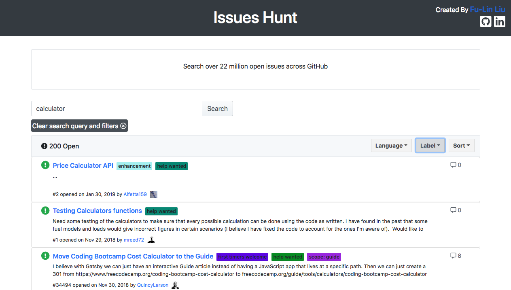

# Issues Hunt 
#
Issues such as "good first issue" or "help wanted" are difficult to find. Right now a user would have to click on a specific repository and look through their issues to apply label filters. Being able to find issues easier would encourage more people, especially novice programmers, to contribute to open source projects.
### User Story:
* User can search for GitHub Issues across all repositories
* User can filter results by language and label
* User can then sort the results
### [Live Demo](https://issueshunt.herokuapp.com/)

## Running locally
1. `git clone https://github.com/fulin426/Issues-Hunt.git`
2. `npm install`
3. `npm start`
Information for Search Issues as part of GitHub Developer Search API
#### [GitHub Search API](https://developer.github.com/v3/search/#search-issues-and-pull-requests)

Contributed by Ardelyo for GitHub Achievement
